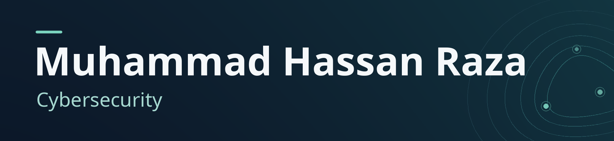

# 

I’m a cybersecurity professional at the National Radio Telecommunication Corporation (NRTC), based in Islamabad, Pakistan. My work centers on digital forensics and incident response, and I have a background in network security and web development.

[LinkedIn](https://www.linkedin.com/in/hassanraza30/) · [Previous GitHub profile](https://github.com/TheWizard4k)

## Areas of focus

- **Digital forensics and incident response** · Examining digital evidence and documenting findings.
- **Security operations** · Blue-team workflows, security monitoring, and SIEM with IBM QRadar.
- **Network security and scripting** · Network defense and PowerShell scripting.

## Selected projects

- **[PowerShell Lab](https://github.com/TheWizard4k/Power-Shell-Script)** · PowerShell scripting practice from a training lab.
- **[Cash & Carry](https://github.com/TheWizard4k/Cash-Carry)** · A C++ invoice management system built as a semester project.
